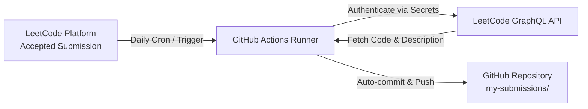

# LeetCode Solutions & Automated Portfolio

[](https://github.com/Sherifred-singh/leetcode-solutions/actions/workflows/leetcode-sync.yml)
[](https://leetcode.com/Sherifred/)
[](https://github.com/Sherifred-singh)
[](https://en.wikipedia.org/wiki/C_(programming_language))

> Automated synchronization repository capturing all accepted LeetCode problem solutions, algorithmic complexity breakdowns, and technical interview patterns.

---

## 📊 Live LeetCode Profile Stats

<div align="center">
  
</div>

---

## ⚙️ How Automated Synchronization Works



1. **Daily Automation:** The GitHub Actions workflow (`.github/workflows/leetcode-sync.yml`) runs every day at 08:00 UTC (1:30 PM IST).
2. **On-Demand Trigger:** Can also be triggered manually anytime via the GitHub Actions tab (`workflow_dispatch`).
3. **Structured Storage:** Each accepted problem is automatically placed into its own folder inside `my-submissions/` along with the question statement, tags, and solution code.

---

## 🚀 Setup Instructions (One-Time Setup)

### Step 1: Retrieve your LeetCode Cookies from Chrome
Since you are already logged into LeetCode in your browser:
1. Open [LeetCode](https://leetcode.com) in Google Chrome.
2. Press `F12` (or Right-Click anywhere $\rightarrow$ **Inspect**) to open Chrome Developer Tools.
3. Switch to the **Application** tab at the top.
4. In the left sidebar, expand **Cookies** $\rightarrow$ select `https://leetcode.com`.
5. Find and copy the values for these two cookies:
   - `LEETCODE_SESSION`
   - `csrftoken`

---

### Step 2: Add Secrets to your GitHub Repository
1. Go to your GitHub repository: `https://github.com/Sherifred-singh/leetcode-solutions/settings/secrets/actions`
2. Click **New repository secret**.
3. Add the first secret:
   - **Name:** `LEETCODE_SESSION`
   - **Secret:** *(Paste the `LEETCODE_SESSION` cookie value copied in Step 1)*
4. Click **New repository secret** again to add the second secret:
   - **Name:** `LEETCODE_CSRF_TOKEN`
   - **Secret:** *(Paste the `csrftoken` cookie value copied in Step 1)*

---

### Step 3: Trigger the First Sync
1. Navigate to the **Actions** tab in your GitHub repository.
2. Select **Sync LeetCode Submissions** in the left menu.
3. Click **Run workflow** $\rightarrow$ **Run workflow**.
4. In ~60 seconds, all your accepted solutions will be downloaded, formatted, and committed to your repo!

---

## ⚡ Alternative: Real-Time Sync via Chrome Extension (LeetHub)

If you prefer solutions to be pushed **instantly** the exact moment you hit **Submit** on LeetCode:
1. Install the [LeetHub v3 Extension](https://chromewebstore.google.com/detail/leethub-v3/kdcnnhnahiejddcjbflnndnjchpaloed) from Chrome Web Store.
2. Click the LeetHub extension icon and select **Authorize with GitHub**.
3. Select your repository: `Sherifred-singh/leetcode-solutions`.
4. Solve any problem on LeetCode—as soon as it shows **Accepted**, LeetHub instantly commits and pushes the code to GitHub in real-time.

---

## 📁 Repository Structure

```text
leetcode-solutions/
├── .github/
│   └── workflows/
│       └── leetcode-sync.yml    # Daily automated sync workflow
├── my-submissions/              # Destination folder for synced solutions
│   ├── 0001-two-sum/
│   │   ├── README.md            # Problem statement & difficulty
│   │   └── two-sum.c            # Solution source code
├── scripts/
│   └── sync_leetcode.py         # Local Python fallback sync script
├── .gitignore
├── .env.example
└── README.md
```

<!---LeetCode Topics Start-->
# LeetCode Topics
## Linked List
| Problem Name | Difficulty |
| ------- | ------- |
| [0002-add-two-numbers](https://github.com/sherifred-singh/leetcode-solutions/tree/main/0002-add-two-numbers/) | Medium |
## Math
| Problem Name | Difficulty |
| ------- | ------- |
| [0002-add-two-numbers](https://github.com/sherifred-singh/leetcode-solutions/tree/main/0002-add-two-numbers/) | Medium |
## Recursion
| Problem Name | Difficulty |
| ------- | ------- |
| [0002-add-two-numbers](https://github.com/sherifred-singh/leetcode-solutions/tree/main/0002-add-two-numbers/) | Medium |
<!---LeetCode Topics End-->